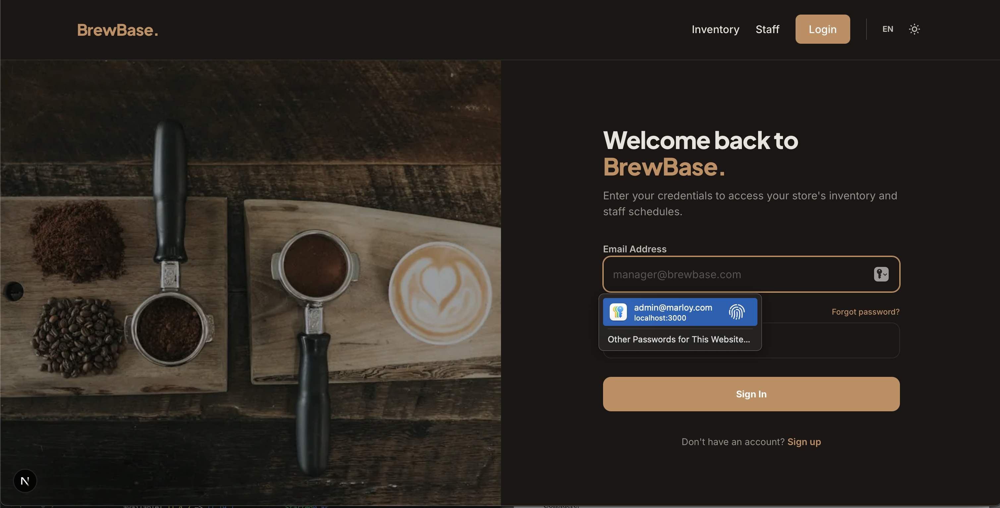

# Marloy



Administrative system for managing **Marloy’s** clients, machines, supplies, maintenance, and consumption, built using the custom [mysql-orm-lite](<>) database package for typed database access.

> Reference: Original task [Consigna.pdf](/docs/Consigna.pdf)

<!-- > La empresa “Cafés Marloy” planea implementar un sistema administrativo para gestionar
> sus máquinas expendedoras de café distribuidas en distintos clientes, así como el control de
> insumos, proveedores, técnicos y consumos.
> [<small>Consigna.pdf</small>](/docs/Consigna.pdf) -->

## Development

```bash
docker compose up -d --build
```

> Requires: Secrets set `JWT_KEY`**(+1)** at [.env](./.env) (see ref. [.env.example](.env.example))

## Production

```bash
docker compose up -d --build
```

> Requires: Secrets set `JWT_KEY`**(+1)** at [.env](./.env) (see ref. [.env.example](.env.example))

## Debugging

```bash
docker exec -it mysql-server mysql -u appuser -p -D gestion_comercial
```

## Learn More

Project developed along side [mysql-orm-lite](<>) (a python ORM package). Resources:

- [Backend](/backend/README.md): Python + FastAPI Original documentation.
  - [Public API](/frontend/README.md#endpoints-publicos): CURL routes for query and update commands.
  - [Internal API](/frontend/README.md#autenticacion): User authentication and token management.
- [Task](/docs/Consigna.pdf): Instructions, timeframe, requirements, etc.

<!-- - [mysql-orm-lite](<>): Custom ORM - Database management. -->
<!-- - [Frontend](/frontend/README.md): Original Next documentation (unused). -->
